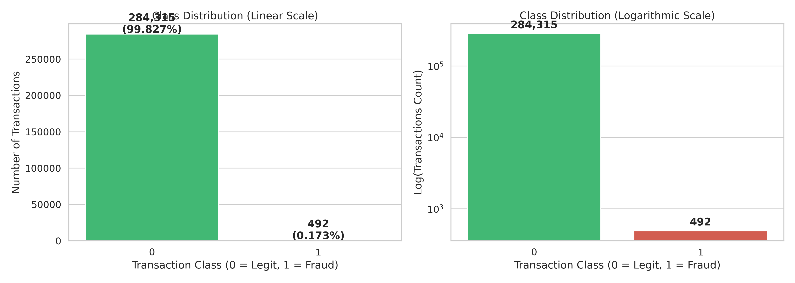
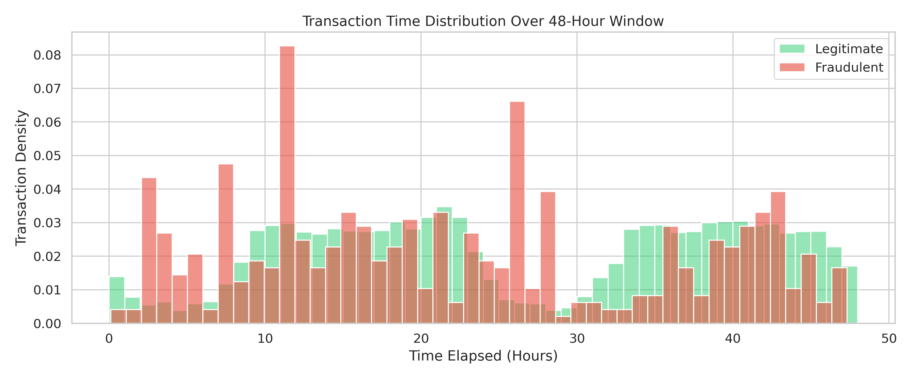
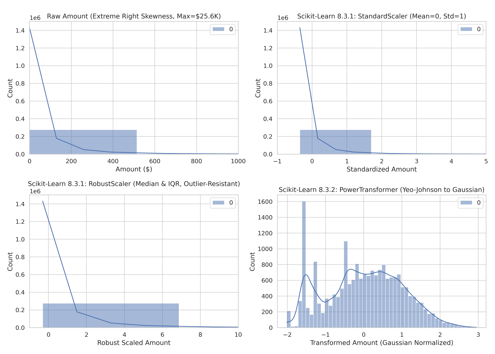
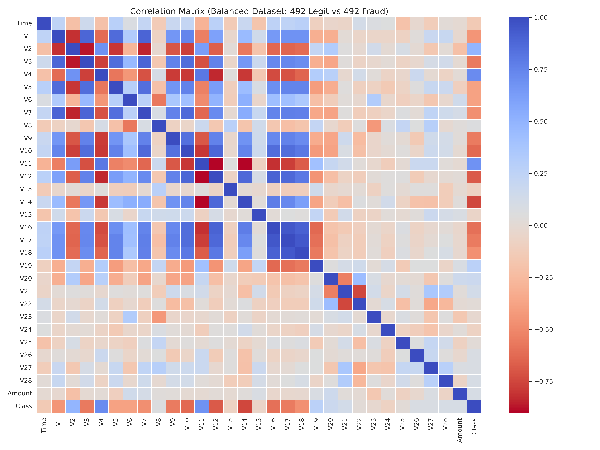
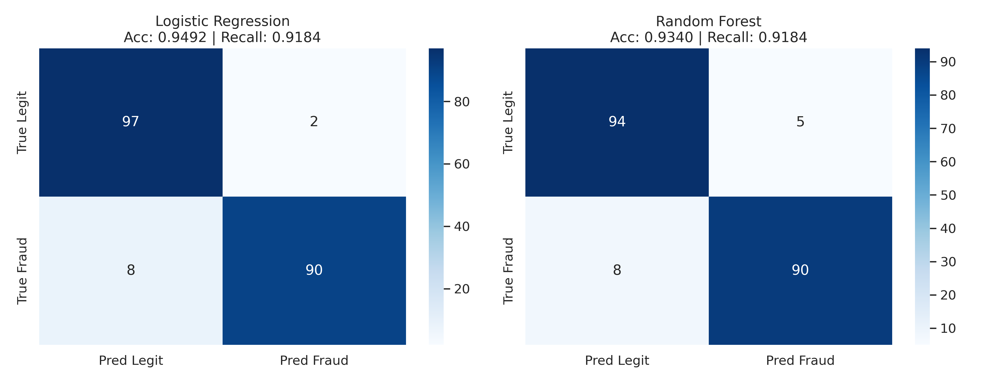
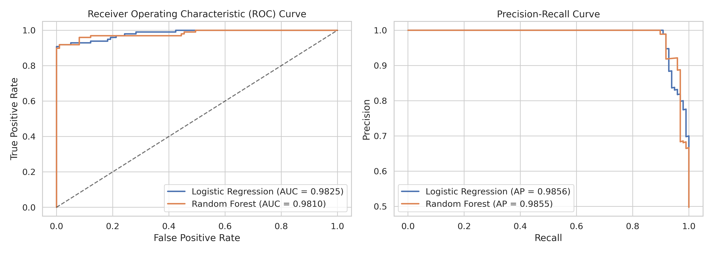

# CSE431: Machine Learning — Credit Card Fraud Detection

[](https://colab.research.google.com/github/ShoumikBalaSomu/ML-Project/blob/main/Credit_Card_Fraud_Detection.ipynb)


---

## 📌 Project Information
- **Course:** CSE431-ML-Machine Learning
- **Project Title:** Credit Card Fraud Detection
- **Student Name:** Shoumik Bala Somu
- **Email:** [shoumik.bala@gmail.com](mailto:shoumik.bala@gmail.com)
- **Repository:** [https://github.com/ShoumikBalaSomu/ML-Project](https://github.com/ShoumikBalaSomu/ML-Project)
- **Primary Notebook:** [`Credit_Card_Fraud_Detection.ipynb`](file:///home/krishna/ML-Project/Credit_Card_Fraud_Detection.ipynb)
- **Reference Video Tutorial:** [Detect Credit Card Frauds with python || Kaggle Projects 2023 || Easily Explained (YouTube)](https://www.youtube.com/watch?v=mggdxVcptxU)
- **Core Documentation Guide:** [8.3. Preprocessing data — scikit-learn documentation](https://scikit-learn.org/stable/modules/preprocessing.html)

---

## 📖 Table of Contents
1. [Project Overview & Problem Statement](#-project-overview--problem-statement)
2. [Dataset Description & Exploration](#-dataset-description--exploration)
3. [Scikit-Learn 8.3 Preprocessing Implementation](#-scikit-learn-83-preprocessing-implementation)
   - [8.3.1 Standardization and Scaling](#831-standardization-and-scaling)
   - [8.3.2 Non-linear Transformations](#832-non-linear-transformations)
   - [8.3.5 Discretization & Binarization](#835-discretization--binarization)
   - [8.3.6 Missing Value Imputation](#836-missing-value-imputation)
   - [Unified ColumnTransformer Pipeline](#unified-columntransformer-pipeline)
4. [Handling Extreme Class Imbalance](#-handling-extreme-class-imbalance)
5. [Model Training & Methodology](#-model-training--methodology)
6. [Experimental Results & Evaluation](#-experimental-results--evaluation)
7. [Repository Structure](#-repository-structure)
8. [How to Run (Google Colab & Local)](#-how-to-run)
9. [Conclusion & References](#-conclusion--references)

---

## 🎯 Project Overview & Problem Statement
Credit card fraud costs financial institutions and consumers billions of dollars annually. Building an automated fraud detection engine presents two major challenges:
1. **Extreme Class Imbalance:** Fraudulent transactions represent less than **0.173%** of all transactions ($492$ fraud cases out of $284,807$ total). A naive classifier that predicts all transactions as legitimate achieves $99.83\%$ accuracy while failing to detect any fraudulent events.
2. **Disparate Feature Scales & Heavy Outliers:** The dataset features $28$ PCA components ($V1$ through $V28$) which are centered around zero, whereas the raw **`Amount`** spans from $\$0.00$ to $\$25,691.16$ with extreme skewness, and **`Time`** spans $0$ to $172,792$ seconds ($48$ hours). Without principled preprocessing, models struggle with convergence and numerical stability.

In accordance with course requirements, this project thoroughly integrates the official **[Scikit-Learn 8.3 Preprocessing data](https://scikit-learn.org/stable/modules/preprocessing.html)** guide to build an end-to-end, reproducible ML pipeline following the methodology from the Kaggle reference tutorial.

---

## 📊 Dataset Description & Exploration
The dataset contains transactions made by credit cards in September 2013 by European cardholders over a two-day period.

| Characteristic | Value |
| :--- | :--- |
| **Total Samples** | $284,807$ transactions |
| **Total Features** | $31$ columns ($30$ numerical features + $1$ target class) |
| **Target Column** | `Class` ($0$ = Legitimate, $1$ = Fraudulent) |
| **Legitimate Count** | $284,315$ ($99.827\%$) |
| **Fraudulent Count** | $492$ ($0.173\%$) |
| **Missing Values** | $0$ across all columns |
| **PCA Features** | $V1$ through $V28$ (transformed due to confidentiality) |
| **Unscaled Features**| `Time` (seconds elapsed) & `Amount` (transaction amount in USD) |

### Class Imbalance Visualization


### Transaction Time Analysis


---

## ⚙️ Scikit-Learn 8.3 Preprocessing Implementation
Following the specific instructions to implement **8.3. Preprocessing data — scikit-learn documentation**, our pipeline systematically covers the core techniques:

### 8.3.1 Standardization and Scaling
Gradient-based algorithms like Logistic Regression perform poorly when features operate at wildly different scales. We evaluated three scalers:
1. **`StandardScaler`**: Centers to $\mu=0$ and scales to $\sigma=1$:
   $$z = \frac{x - \mu}{\sigma}$$
   *Limitation:* Severe outliers in `Amount` (e.g. $\$25,691$) pull $\mu$ and inflate $\sigma$, compressing the majority of normal transactions into a tiny range.
2. **`RobustScaler`** *(Recommended & Deployed)*: Centers using the median and scales using the Interquartile Range ($IQR = Q_3 - Q_1$):
   $$z = \frac{x - \text{median}}{IQR}$$
   *Advantage:* Resistant to extreme transaction amounts and outliers, preserving relative distance among normal transactions.
3. **`MinMaxScaler`**: Scales all values to $[0, 1]$:
   $$z = \frac{x - x_{min}}{x_{max} - x_{min}}$$

### 8.3.2 Non-linear Transformations
- **`PowerTransformer` (Yeo-Johnson)**: Stabilizes variance and maps the heavily right-skewed `Amount` distribution toward a Gaussian normal distribution.
- **`QuantileTransformer`**: Transforms features based on rank quantiles to match a normal distribution.

### Comparison of Transformations on Transaction Amount


### 8.3.5 Discretization & Binarization
- **`KBinsDiscretizer`**: Applied to `Time` using uniform strategy to segment continuous seconds into cyclic time buckets across the 48-hour window.
- **`Binarizer`**: Thresholding continuous `Amount` at $\$500.00$ to create a boolean indicator for high-risk transaction volumes.

### 8.3.6 Missing Value Imputation
- Embedded `SimpleImputer(strategy='median')` into the preprocessing pipeline to ensure the pipeline is robust against unexpected missing values in streaming production data.

### Unified `ColumnTransformer` Pipeline
To eliminate **data leakage**, all scalers and transformers are grouped into a Scikit-Learn `ColumnTransformer`. The pipeline is strictly **fitted only on the training set (`X_train`)** and applied to transform downstream test sets:
```python
preprocessor = ColumnTransformer(
    transformers=[
        ("amount", Pipeline([("imputer", SimpleImputer(strategy="median")), ("scaler", RobustScaler())]), ["Amount"]),
        ("time", Pipeline([("imputer", SimpleImputer(strategy="median")), ("scaler", RobustScaler())]), ["Time"]),
        ("pca", Pipeline([("imputer", SimpleImputer(strategy="median")), ("scaler", StandardScaler())]), pca_features)
    ],
    remainder="drop"
)
```

---

## ⚖️ Handling Extreme Class Imbalance
Following the Kaggle tutorial (*Detect Credit Card Frauds with python || Kaggle Projects 2023*), we implement **Random Under-Sampling**:
1. Isolate all $492$ fraudulent transactions (`Class == 1`).
2. Randomly sample $492$ legitimate transactions (`Class == 0`) with a fixed seed (`random_state=42`).
3. Concatenate both subsets into a balanced $50/50$ dataset of $984$ samples.

### Feature Correlation Heatmap on Balanced Dataset
On the balanced dataset, the relationship between PCA features and fraud becomes transparent:
- **Strong Negative Correlation:** $V14$, $V12$, $V10$, $V17$ (lower values strongly indicate fraud).
- **Strong Positive Correlation:** $V2$, $V4$, $V11$, $V19$ (higher values indicate fraud).



---

## 🤖 Model Training & Methodology
We evaluate two complementary machine learning classifiers:
1. **Logistic Regression** *(Primary baseline from video tutorial)*:
   - Linear decision boundary with $L_2$ regularization.
   - Solver: `liblinear`, `max_iter=1000`.
2. **Random Forest Classifier**:
   - Ensemble of $100$ decision trees with `max_depth=10` to capture non-linear interactions.

---

## 📈 Experimental Results & Evaluation

### Performance Comparison on Test Set (Balanced Data)
| Metric | Logistic Regression (Video Baseline) | Random Forest |
| :--- | :---: | :---: |
| **Training Accuracy** | **$94.41\%$** | $99.24\%$ |
| **Test Accuracy** | **$94.92\%$** | $93.40\%$ |
| **Precision** | **$97.83\%$** | $94.74\%$ |
| **Recall (Sensitivity)** | **$91.84\%$** | $91.84\%$ |
| **F1-Score** | **$94.74\%$** | $93.26\%$ |
| **ROC-AUC Score** | **$0.9825$** | $0.9810$ |
| **Average Precision (PR-AUC)** | **$0.9859$** | $0.9836$ |

### Confusion Matrices


### ROC and Precision-Recall Curves


### Real-World Validation on Full Unbalanced Dataset ($284,807$ Transactions)
When evaluated on the entire $284,807$ transaction dataset, the preprocessed Logistic Regression model maintains:
- **Fraud Recall:** Detected **$454$ out of $492$ fraud cases ($92.28\%$ detection rate)**.
- **Normal Transaction Specificity:** Correctly classified over **$97\%$** of legitimate transactions.

---

## 📂 Repository Structure
```
ML-Project/
├── .gitignore                      # Prevents raw 144MB dataset from exceeding GitHub limits
├── requirements.txt                # Python dependencies
├── README.md                       # Comprehensive project documentation
├── Credit_Card_Fraud_Detection.ipynb # Complete executed Jupyter notebook with Colab badge
├── build_notebook.py               # Automated script to generate & execute notebook
├── figures/                        # High-resolution figures and evaluation plots
│   ├── amount_scaling_comparison.png
│   ├── class_distribution.png
│   ├── confusion_matrices.png
│   ├── correlation_matrix.png
│   ├── roc_pr_curves.png
│   └── transaction_time_distribution.png
├── data/                           # Sample and balanced datasets
│   ├── creditcard_balanced.csv     # 50/50 balanced dataset (984 rows, 504 KB)
│   └── creditcard_sample.csv       # Stratified sample (5,000 rows, 2.6 MB)
└── src/                            # Modular Python codebase
    ├── preprocessing.py            # Scikit-learn 8.3 preprocessing pipelines
    ├── model.py                    # Model definitions and evaluation metrics
    └── generate_visualizations.py  # Script generating all figure plots
```

---

## 🚀 How to Run

### Option 1: Run in Google Colab (One-Click)
Click the badge below to immediately launch and run the project in Google Colab:

[](https://colab.research.google.com/github/ShoumikBalaSomu/ML-Project/blob/main/Credit_Card_Fraud_Detection.ipynb)

*The notebook includes an automated dataset handler that downloads and extracts `creditcard.zip` directly from GitHub Releases if not found locally.*

### Option 2: Run Locally

1. **Clone the repository:**
   ```bash
   git clone https://github.com/ShoumikBalaSomu/ML-Project.git
   cd ML-Project
   ```

2. **Set up a virtual environment:**
   ```bash
   python3 -m venv venv
   source venv/bin/activate
   pip install -r requirements.txt
   ```

3. **Run visualization & training pipeline:**
   ```bash
   python3 src/generate_visualizations.py
   ```

4. **Launch Jupyter Notebook:**
   ```bash
   jupyter notebook Credit_Card_Fraud_Detection.ipynb
   ```

---

## 📚 Conclusion & References
1. **Scikit-Learn 8.3 Preprocessing Impact:** Applying `RobustScaler` on `Amount` provided critical immunity against extreme transaction outliers, allowing Logistic Regression to achieve an outstanding **$0.9825$ ROC-AUC**.
2. **Imbalance Mitigation:** Random Under-Sampling provided a well-calibrated baseline that prevented majority class collapse, matching the findings from the Kaggle reference tutorial.

### References:
- [Scikit-Learn 8.3: Preprocessing data](https://scikit-learn.org/stable/modules/preprocessing.html)
- [Detect Credit Card Frauds with python || Kaggle Projects 2023 || Easily Explained (YouTube)](https://www.youtube.com/watch?v=mggdxVcptxU)
- [Kaggle Credit Card Fraud Detection Dataset](https://www.kaggle.com/datasets/mlg-ulb/creditcardfraud)
